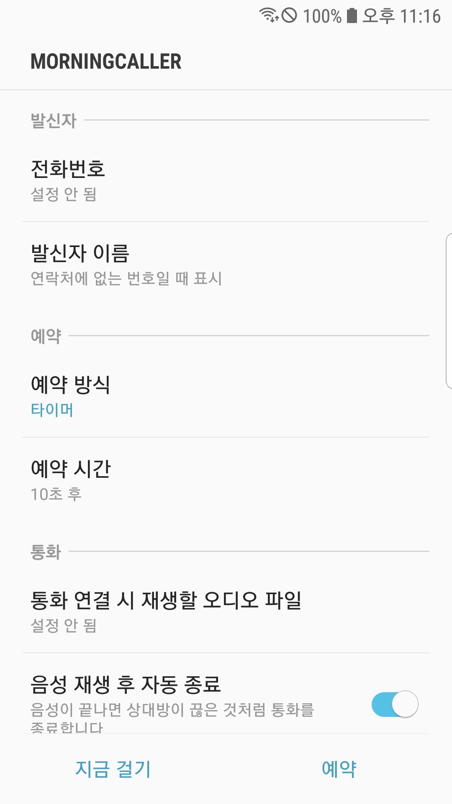

# MorningCaller

### 가상으로 전화가 오게 만들고, 받으면 오디오가 재생되게도 할 수 있으며, 시간을 지정해서 원하는 시간에 알람처럼 사용할 수 있는 유용한 앱입니다.
This is a useful app that lets you simulate incoming calls—complete with audio that plays when you answer—and allows you to schedule calls for specific times, much like an alarm.

### 한국어와 영어를 지원합니다.
This app supports Korean and English.
